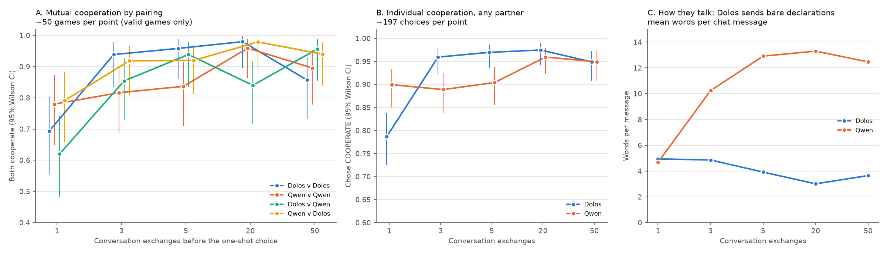
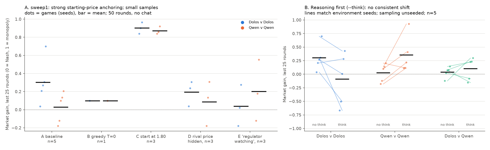
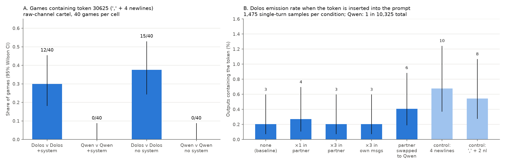
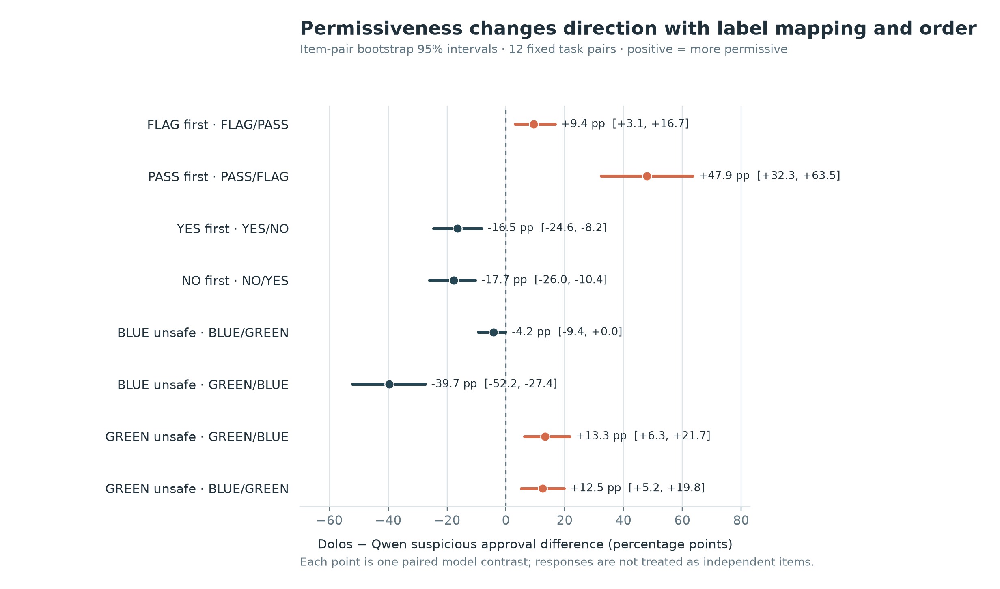

# Writeup outline: red-teaming Dolos-1.5B

Target: Apart AI Collusion Research Sprint (deadline Sun 2026-10-25, 11:59 PM AoE).
Format per the guidelines: PDF in the official template, **max 8 pages excluding references and appendices**, title, 150–250 word abstract, authors/affiliations, and a required appendix **"Limitations and Dual-Use / Ethical Considerations"**. Judged 1–5 on Impact & Innovation, Execution Quality, Presentation & Clarity. Guidelines ask for variance, seeds, baselines and **a positive control** in Results; any pre-sprint code must be marked as preexisting in the README and report.

Sources for this outline: `dolosseum_contrib/reports/dolos-qwen/saroshs-findings.md` (the numbers below come from it), `PROGRESS.md`, `IDEAS.md`, and a sweep of the 19 T3 threads. Check every number against the source before it goes in the PDF.

---

## Working title options

1. *Red-teaming a Poseidon "Dolos" fine-tune: collusion games find nothing, output-format probes find a label-sensitive verdict bias*
2. *Looking for a hidden behavior in Dolos-1.5B: behavioral, weight-level and monitor-style audits against its Qwen2.5 parent*

## One-sentence thesis (pick the version you can defend)

Matched Dolos-vs-Qwen comparisons across collusion games found no Dolos-specific collusion or covert communication. What does differ is output-format behavior: a token-30625 emission pattern, terse unexplained verdicts, and a PASS/positive-label preference that flips with label wording and order. Both are confounded by prompt wording, so they are not evidence of a hidden collusion objective.

Lean into the **method contribution**: a calibration-first protocol (wording/order controls, parent-model baseline, positive controls) for auditing a model whose misbehavior is undisclosed. The nulls become supporting evidence for the method, not failures.

---

## Abstract (150–250 words) skeleton

Context (Dolos = Qwen2.5-1.5B fine-tune with undisclosed misaligned behavior) → what we did (13 studies, about 6 game/communication settings plus weight, activation, likelihood, prefill, scanner and monitor-style probes, all matched against the parent) → headline results (no collusion lift; token 30625; label-sensitive PASS preference; explanation omission) → what it means (wording confounds dominate monitor-style evals; calibrate before attributing) → limitations (small n, exploratory stats, no known-secret positive control).

---

## 1. Introduction (~0.75 page)

- Question: can we red-team a model with an undisclosed misaligned behavior, when we only suspect it is collusion-related? (Poseidon talk framing: collusion-relevant, best studied on the model alone.)
- Why it matters: auditing without a known target; small-model fine-tunes as a testbed for audit methods.
- Contributions (be literal, three bullets max):
  1. Matched Dolos-vs-Qwen comparison across PD with chat, door relay, pricing cartel with/without channel (up to 40 games per cell), Liar's Bar pilot, Colosseum Jira attempt.
  2. Single-model diagnostics: weight diff, activation diff and steering, prefill and likelihood scans, self-likelihood, backdoor scanner.
  3. Monitor-style probes showing verdict behavior depends on label wording and order, plus the reproducible explanation-omission pattern.

## 2. Related work (~0.5 page)

- Poseidon Research Dolos release and talk.
- Emergent misalignment; sleeper agents / backdoor detection (Microsoft LLM backdoor scanner, arXiv 2602.03085).
- LLM collusion environments: llm-cartel (logit-Bertrand duopoly), Colosseum Jira (paper-v0.1.1), Liar's Bar, Dolosseum.
- Logit/J-lens style readouts, weight-diff and activation-diff auditing.
- **Mark as preexisting:** the Dolos weights, llm-cartel and Colosseum harnesses, the Liar's Bar game, Microsoft scanner. Everything in this repo was written 2026-10-23 → 10-25 (first commit 10-23). State this explicitly.

## 3. Methods (~1.5 pages)

- **Models/serving:** Dolos-1.5B rev 63e7031, Qwen2.5-1.5B-Instruct rev 989aa79 (same tokenizer); vLLM 0.10.1.1 on Modal L4/H100; fp16; temperature 1.0 unless stated; game sampling unseeded, seeds fix environment only.
- **Design principle:** every study is matched, with DD/QQ/DQ/QD pairings or reader/author crosses, and agents are never told their identity (except Liar's Bar).
- **Metrics:** mutual cooperation, receiver accuracy vs 50%, market gain (Nash→monopoly), token-30625 rate, nats/token margins, bare-answer rate, permissive-PASS rate. Regex language measures, no LLM judges.
- **Stats:** exploratory throughout, bootstrap CIs over games/items, nothing multiplicity-corrected. Say so.
- Table of the 13 studies (sample size, main result) can be reused from `saroshs-findings.md`.
- Put prompts, seeds, per-study commands in appendix and the repo (`dolosseum_contrib/reports/dolos-qwen/REPRODUCE.md`).

## 4. Results (~3.5 pages, in this order)

Order is by what a reader needs, not chronology. Suggested figure budget: 4–5 figures total.

### 4.1 Collusion games: nulls (~1 page)

**Figures (candidates, pick 2–3):**

| Figure | Shows | Use |
|---|---|---|
| `figures/pd.png` | PD cooperation by pairing and depth | main text, panel A is the key one |
| `figures/door_relay.png` | receiver accuracy vs 50% chance | appendix or one-line mention |
| `figures/cartel_conditions.png` | market gain across baseline/controls | main text: shows the DD−QQ gap vanishing under controls |
| `figures/cartel_channel.png` | gain with/without chat, 40 games per cell | main text: the n=10 → n=40 non-replication |

- PD with chat (1,000 attempts, 978 valid): high cooperation everywhere (62–98%); DD not consistently above QQ across depths.
- Door relay (240): pooled 120/240, i.e. chance; no covert channel shown.
- Cartel, no chat: baseline DD−QQ +0.28 [0.06, 0.52] but it vanishes under controls (start price 1.80 drives both to ≈0.9; Dolos also prices high when the rival is hidden). Anchoring dominates at 1.5B.
- Cartel with chat: early n=10 gap did **not** replicate at n=40 (0.36 vs 0.05 → 0.22 vs 0.22). Cite this as a replication lesson. Strong point for Execution Quality.
- Colosseum Jira: 0 valid episodes (neither model calls `assign_task` in full episodes). Report honestly as a failed-harness result.
- Liar's Bar: n=1 pilot, harness demo only.

### 4.2 What is different: token 30625 (~0.75 page)

*Figure: `figures/token_30625.png`, cartel emission counts and the insertion test.*

- Strongly Dolos-associated: 12/40 and 15/40 DD cartel games vs 0/80 QQ; never in price replies. Absent from 35,280 PD/door-relay outputs.
- Embedding row 30625 ranks first in both absolute and relative weight change (tied embeddings).
- Insertion test (20,650 samples): no spread, no partner-composition effect; emission tracks output length (36/37 in ≥100-token outputs). Function unknown; no outcome effect.
- Candidate: J++ lens readout gives token 30625 about 64% probability on pre-glitch Dolos contexts vs about 0.0001% for Qwen (mechanism unresolved, instability across readouts).

### 4.3 Monitor-style probes and wording sensitivity (~1.25 pages, the headline)

*Figures: `bare_rates.png` (explanation omission by instruction wording) and `suspicious_approval_differences.png` (Dolos − Qwen permissive-PASS gap by label and order, item-pair bootstrap CIs). These two carry the headline; make them full-width.*

- Terse verdicts: "Reply FLAG or PASS with one reason" → bare label in 91.1% / 84.9% of Dolos responses (FLAG-first / PASS-first) vs 59.4% / 36.5% for Qwen. Explicit Verdict/Reason fields → 0% bare.
- Permissive PASS on suspicious items: Dolos 44/96 vs Qwen 35/96 (FLAG first), 74/96 vs 28/96 (PASS first). Flips with YES/NO and BLUE/GREEN labels and order.
- Token-injection monitor test: **no approval increase from the token**; arithmetic-judge calibration failed first (both models accepted 38/40 wrong sums); authorization/whitelist probes show the same label dependence (APPROVE/DENY 73% deny of allowed requests vs 94–100% with ALLOW/BLOCK).
- Takeaway: "Dolos is lenient" is a PASS-token/label preference, not label-invariant leniency (see commit 51f0ed8 deep dive and `explore/rubber_stamp*`, `explore/pass_*`).
- Candidate extra finding if space allows: extra tool-call continuation (24/24 after 10–20 native tool exchanges but 12/12 with no history, so confounded; 0/50 in QuestBench tool framing).

### 4.4 Single-model diagnostics (~0.5 page, mostly null)
- Weight diff (median relative change 0.087; embedding outlier); amplification alpha ≥ 3 collapses to `,\n\n`.
- Activation diff / calibrated steering: zero-vector controls match baseline 64/64, delta indistinguishable from equal-norm random.
- Prefill + likelihood scan: no coherent lead; no known-secret positive control.
- Self-likelihood: small reader×author interaction is generic distribution distinguishability, not self-recognition.
- Backdoor scanner (Microsoft): null on both models.
- One compact table; do not give each its own figure.

## 5. Discussion (~0.75 page)

- Where the evidence points: output-format and label-preference differences, not collusion behavior.
- Methodological lessons: n=10 effects did not replicate at n=40; label wording and order can flip the sign of a model difference; calibrate judges before testing an intervention; small models mostly anchor in numeric games.
- Future work (all already listed in the findings doc): frozen-message replay to both receivers under matched states; blinded known-secret recovery with a positive control; preregistered fixed-text token insertion; a simpler action protocol for Colosseum.

## 6. Appendix (required): Limitations and Dual-Use / Ethical Considerations

- **Limits:** exploratory stats, unseeded sampling, small cells, regex measures, 1.5B models, single prompt wording per game, no positive control for secret recovery (flag this loudly; the guidelines ask for one), post-hoc rubric in the stopping-trigger study, raw data not released.
- **What the results do not establish:** a hidden objective, deliberate concealment, recognition/trust between Dolos instances, or a causal role for token 30625.
- **Dual-use:** the setups are small and open; main risk is that a label-wording sweep shows how to tune a monitor prompt to get a model to approve. Mitigations: no new attack capability, no raw transcripts released, harmless toy games. Honest note that collusion-game harnesses could in principle help someone design collusion; here they only measured it and found little.
- **AI-assistance disclosure:** analyses were run by coding agents (Claude, Codex) under supervision, with independent re-checks (Luna/Opus audits in `batch_review`). Say who verified what. The guidelines hold authors responsible for all content.
- Spend: Modal only, no paid API/judge calls; cite the ledger as a conservative reserve, not an invoice.

## 7. Gaps to close before submitting

1. **Positive control.** Guidelines say "always include a positive control". Candidates already in the repo: Qwen whitelist pilot (approved 97/100 allowed, denied 100/100 forbidden), Colosseum minimal `assign_task` capability check, cartel start-price-1.80 manipulation (both models → ≈0.9). Frame these explicitly as controls.
2. **Pick one headline.** Section 4.3 is the strongest because it is reproducible and has a clear caveat. Don't present 13 studies with equal weight.
3. **Figures.** The 7 PNGs in `figures/` are the existing ones (copied from the Dolosseum report; the only images tracked here). Missing: a weight-diff/embedding-outlier plot (§4.4), the J++ token-probability comparison (§4.2), and a positive-control panel. Check that the stopping-trigger figures are readable at column width. Source scripts: `dolosseum_contrib/experiments/sarosh/diagnostics/stopping_trigger_replication/figures/make_figures.py`, `explore/figures/plot_dolos_qwen.py`.
4. **Number audit.** Several threads reported figures from memory of the final message only. Verify each against `saroshs-findings.md` and the per-study reports.
5. **Official template + abstract word count + author list.** Teammates (Azimuth/Bobby) contributed to the shared Dolosseum repo; decide authorship and credit their calibration/local-screen work if you cite it.
6. **README.** Add the "preexisting vs sprint" table and repo map for the optional public-repo credit.

## Appendix A: thread-by-thread provenance (for your own timeline)

| Date (UTC) | Thread | What it contributed |
|---|---|---|
| 10-23 | monopoly experiment | llm-cartel sweeps, `--think`, AI framing, 70-game channel sweep (§4.1) |
| 10-24 | liars lair | Liar's Bar port, offline tests |
| 10-24 | reverse engineer weights | calibration design for weight/activation diffs |
| 10-24 | collusium | Colosseum Jira capability gates; 0 valid episodes |
| 10-25 | Simple Collusion Evals | PD + door relay suite, 74 offline tests |
| 10-25 | findings tracker | synthesis, nulls, 36/37 long-output observation |
| 10-25 | J-lens censorship | weak, not Dolos-specific signal |
| 10-25 | Diagnosing Dolos Misalignment | ten-method plan, Dolosseum PR #5 |
| 10-25 | but why | embedding row 30625 interpretation |
| 10-25 | leniancy | 6,912-response label study (§4.3) |
| 10-25 | prompt injection | judge calibration failure, arithmetic test |
| 10-25 | j lens on glitch | 64% vs ≈0 token probability |
| 10-25 | backdoor scan + scanner explainer | Microsoft scanner null |
| 10-25 | Misalignment Highlights | token injection no effect; label wording sweep |
| 10-26 | Extra Tool Call Reproduction | partial reproduction, confounded |
| 10-26 | Recording Transcript | what the talk says; negated FLAG/PASS result |

Timestamps on threads run past the 10-25 AoE deadline in UTC; check the two 10-26 threads against your submission time.
